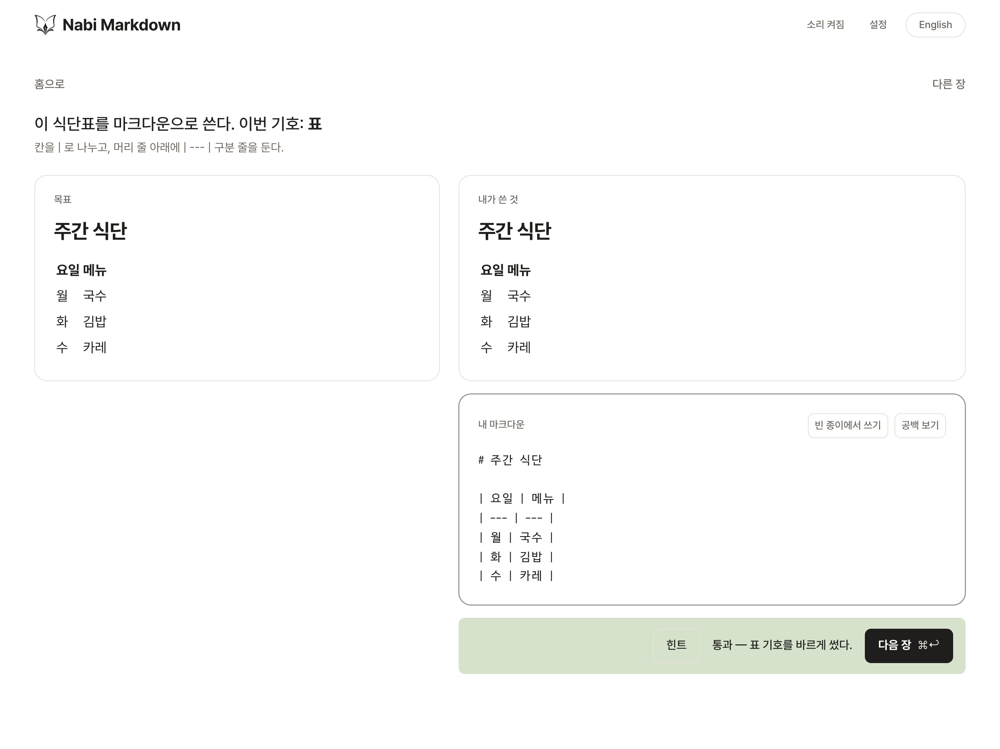
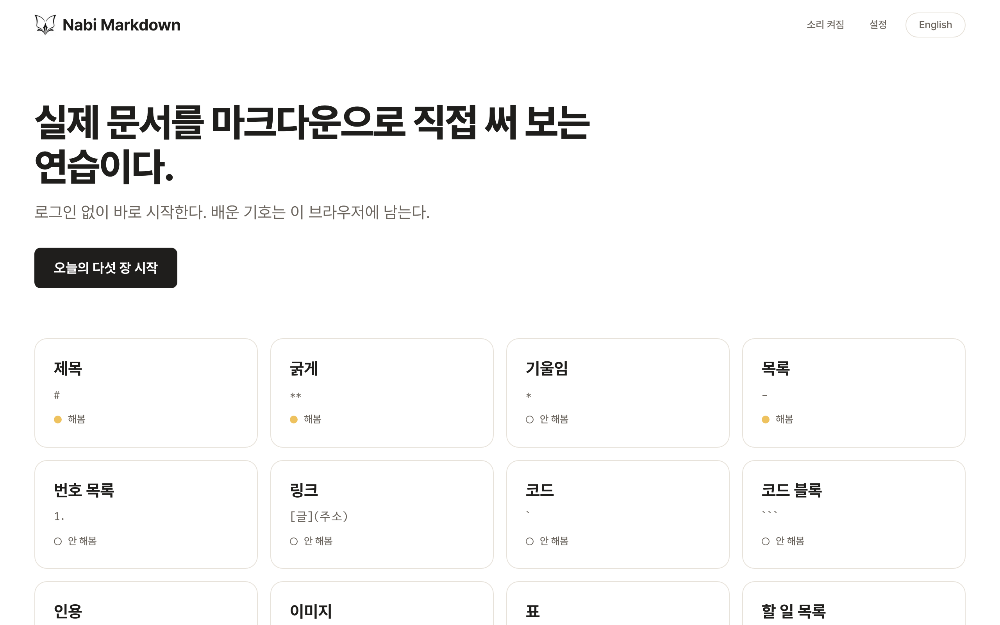

# Nabi Markdown

**Write one short, real document in Markdown, and get it graded by its structure.**

**Live:** [onsoonlabs.com/nabimd/](https://onsoonlabs.com/nabimd/) · Korean first, English too · no login



## What it is

Each exercise is a short document someone would really write: a weekly menu, a
meeting note, a request to an AI assistant. The finished document sits on the
left as the goal. You write its Markdown in the editor on the right and press
Check (⌘↩ or Ctrl+↩).

- **Fill mode first.** The editor starts with the document's words and the
  marks taken out, so you only add the Markdown. "Start from a blank page"
  turns that off for every document.
- **Graded by structure.** A local, deterministic Markdown check compares the
  structure of your document with the goal: headings, lists, tables, emphasis,
  links and so on. Wording, spelling and capitalization do not count. The
  same structure always gets the same verdict, and the app makes no AI calls.
- **Fix it in place.** A miss points at the line when it can and says what is off in one
  sentence. You edit the same draft and check again. Two hints are there when
  you want them, and the answer can be shown after two misses.
- **Twelve marks on a map.** The home page shows heading, bold, italic, list,
  numbered list, link, inline code, code block, quote, image, table and task
  list. Each one is "not tried", "tried" or "familiar" (three passes). Pick a
  mark to practise it, or start **today's five**: five documents that favour
  marks you have not tried, ending on a summary of what you wrote.
- **Two languages.** The Korean screen uses 120 Korean documents written for
  this release. The English screen uses the 316 English Level 1 documents of
  the earlier app. Each language's documents load as their own chunk.
- **Stays in this browser.** Progress is saved in this browser only, with no
  account, and Settings can clear it. Visit statistics run only after you
  agree in the cookie banner. The full list of what is stored is in
  [SECURITY.md](SECURITY.md#scope).



## Run locally

Requires Node.js `22.13`–`22.x`, `24.x`, or `26` or later.

```bash
npm ci
npm run dev
```

`npm run check` runs everything CI runs, and `npm run test:e2e` runs the browser
scenarios. [CONTRIBUTING.md](CONTRIBUTING.md) has the details.

## Data and error reporting

Progress, the language and your consent choice stay in the browser's
`localStorage`; the document you are writing is not stored or sent. Optional
notes from the summary are stored on the server for at most 90 days. Builds
configured with a Sentry DSN send filtered error reports to Sentry. See the
[security and data notice](SECURITY.md#scope) and the
[monitoring details](docs/production-health-monitoring.md).

## History

Nabi Markdown began in July 2026 as an individual entry in OpenAI Build Week.
That version was a drill of five levels, from learning the syntax up to writing
an agent work order, built in Codex sessions, with GPT-5.6 generating and
verifying the problem bank at build time and CodeRabbit reviewing changes
([build log](docs/build-log.md)). In November 2026 Level 1 was rebuilt around
writing whole short documents, with Korean first, progress that stays in the
browser, and the Onsoon Labs hub's design. The plan and its reasoning are in
[dev-docs/plans/2026-11-03-level-1-redesign.md](dev-docs/plans/2026-11-03-level-1-redesign.md).

## Licensing

- **Code:** [GNU Affero General Public License v3.0 or later](LICENSE).
- **Problem-bank content:** [Creative Commons Attribution-ShareAlike 4.0
  International](LICENSE-CONTENT). This includes problem statements, teaching
  copy, Goal documents, and vocabulary ladders.
- **Fonts:** [Pretendard](public/fonts/pretendard/LICENSE.txt) and
  [D2Coding](public/fonts/d2coding/LICENSE.txt) are licensed under the SIL Open
  Font License 1.1.
- **Audio:** the three shipped sound effects are governed by the Mixkit Free
  License and User Terms; see [public/audio/LICENSE.md](public/audio/LICENSE.md).
- **Brand:** see [TRADEMARKS.md](TRADEMARKS.md).

Effective scope: beginning with the commit that introduced `LICENSE-CONTENT`
on July 21, 2026, CC BY-SA 4.0 applies to all problem-bank content present in
this repository and to problem-bank content added later.
