# Level 1 재설계 시안 A·B·C — 비교표

계획서 `dev-docs/plans/2026-11-03-level-1-redesign.md` §4.8의 시안 세 개를 실제 화면으로 만들고(이슈 #251), 같은 문서(장보기 메모: 제목 1 + 목록 3)·같은 색·같은 글꼴로 배치만 다르게 두 폭에서 세 상태를 캡처했다. 세 화면은 `?variant=a|b|c`로 열리고 판정은 실제 엔진(`evaluateProblem`)이 한다. 상태 셋은 Playwright가 에디터에 실제로 입력해 만들었다(`tests/e2e/capture-redesign-variants.spec.ts`, `NABI_WRITE_VARIANT_QA=1`).

Jiwon이 고를 것은 하나다. 기준은 §4.8의 네 줄이고, 아래 자기 평가는 고르는 데 쓰라고 적은 것이지 추천이 아니다.

## 캡처

| 시안 | 1280×800 처음 | 1280×800 다시 | 1280×800 통과 | 390×844 처음 | 390×844 다시 | 390×844 통과 |
|---|---|---|---|---|---|---|
| **A 목표 옆에 쓰기** | 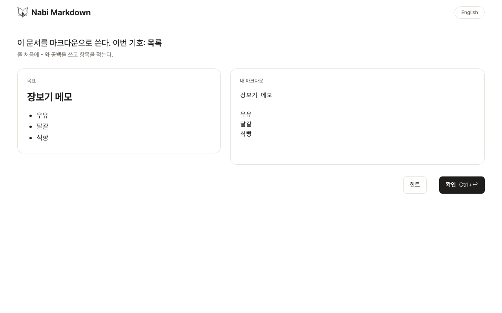 | 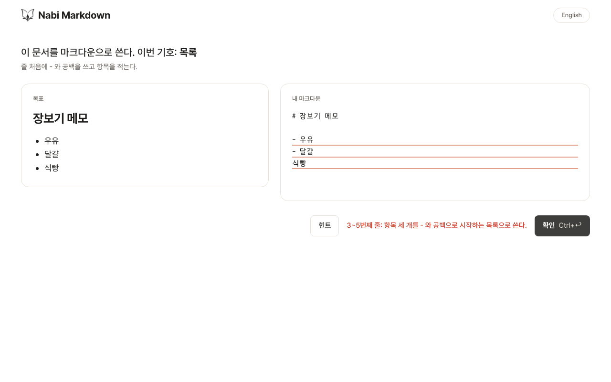 | 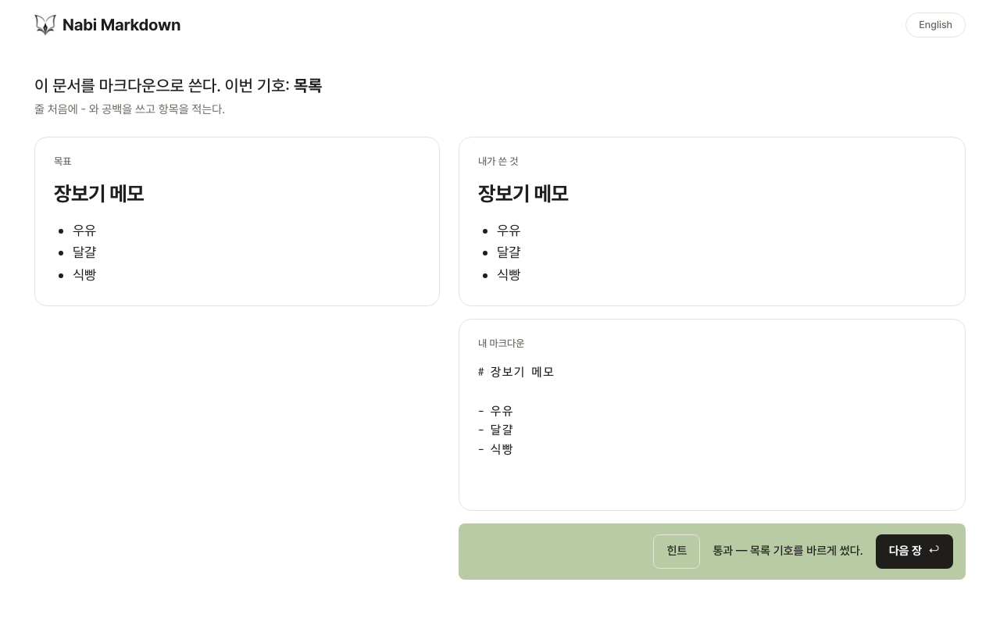 |  | 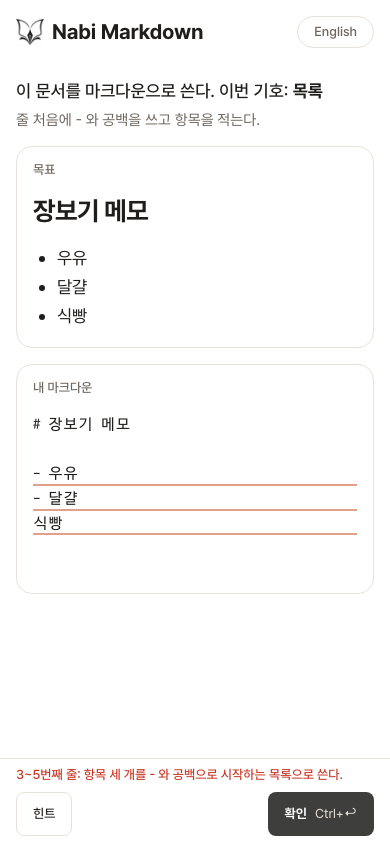 | 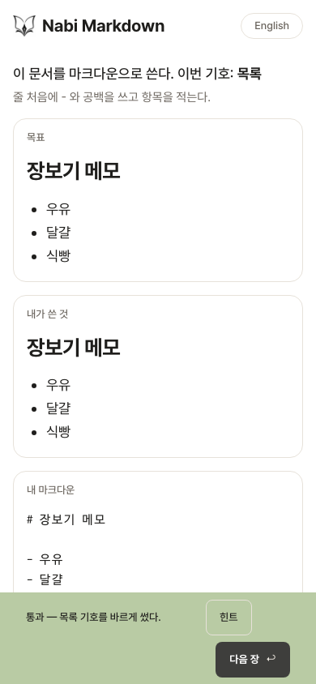 |
| **B 한 줄 집중** | 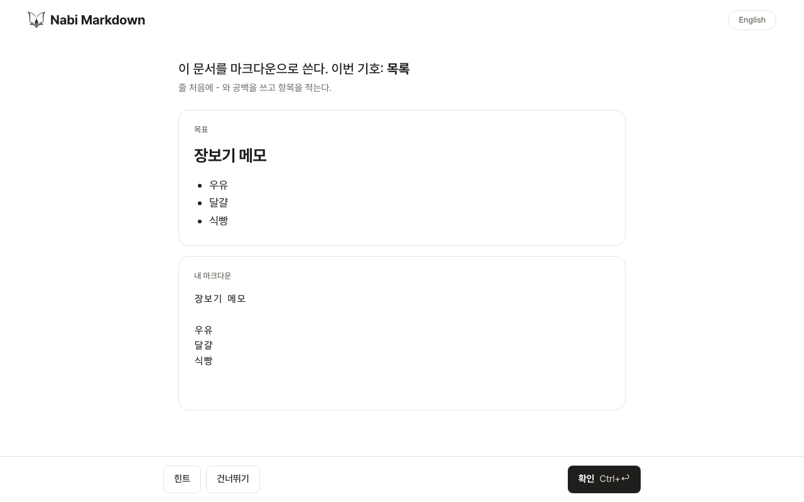 | 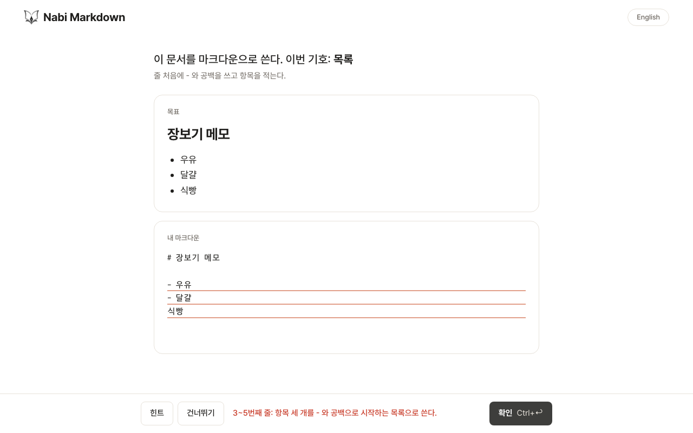 | 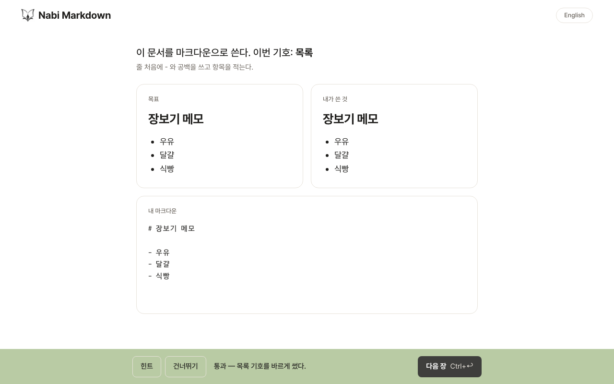 | 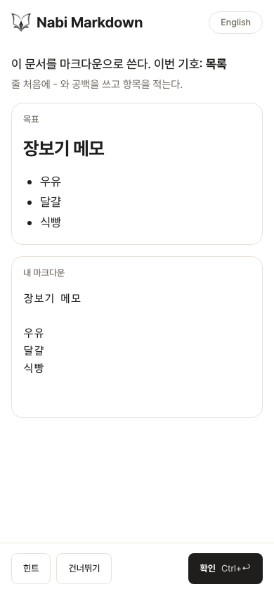 | 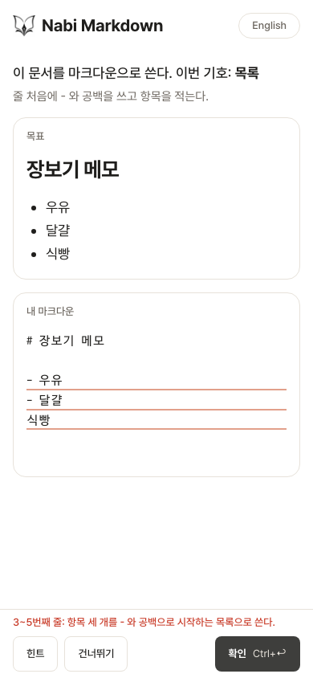 | 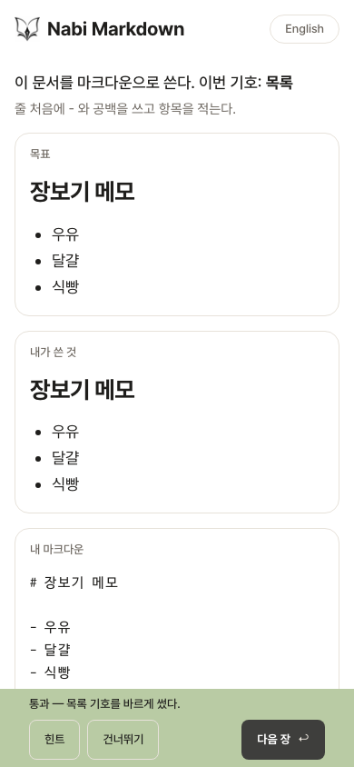 |
| **C 편집기** | 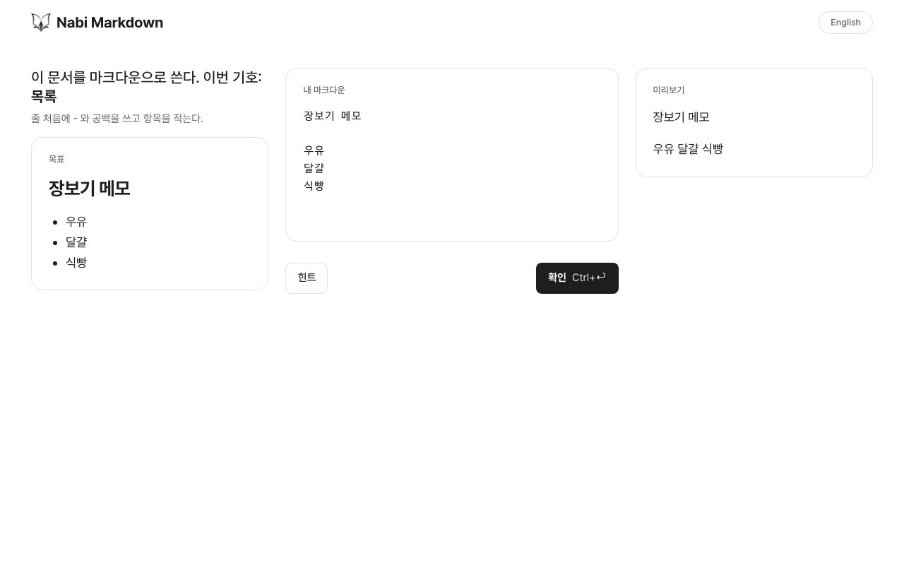 | 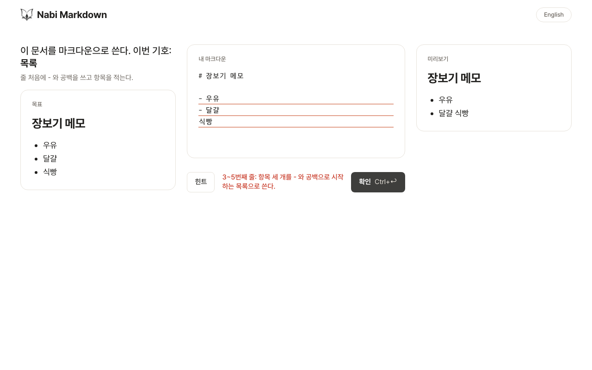 | 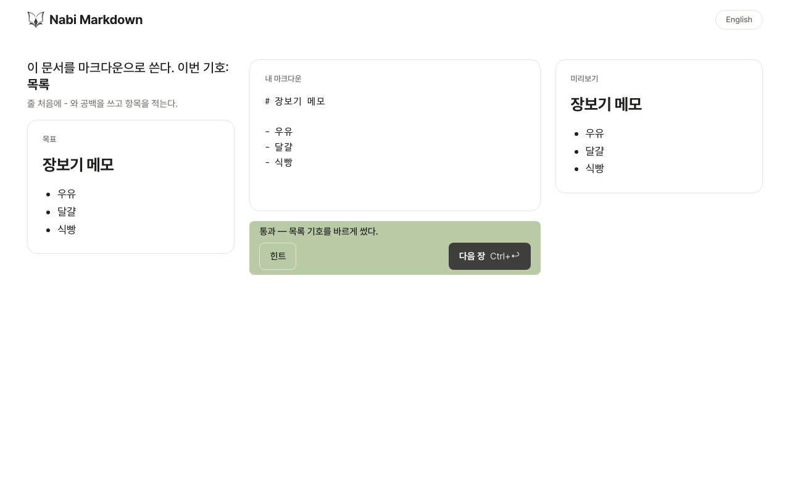 | 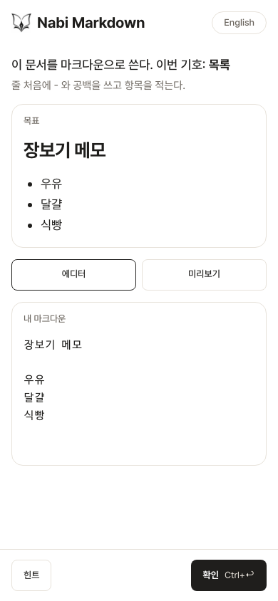 | 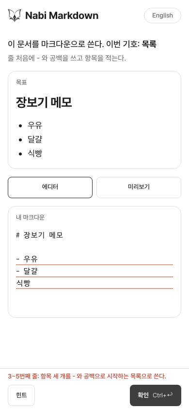 | 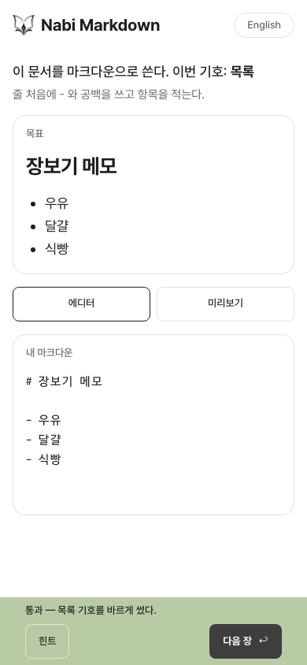 |

허브 제품 페이지(onsoonlabs.com/topki/, 1280)와 세 시안의 1280 '처음'을 나란히 둔 것: 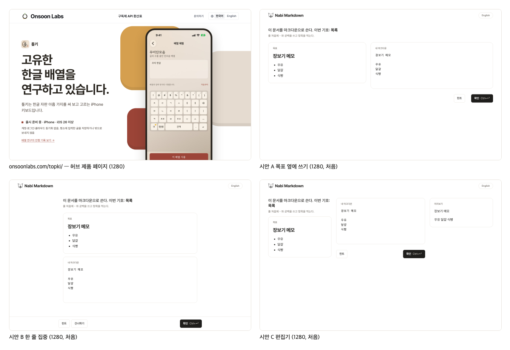 (허브 원본 캡처는 `hub-topki-1280.png`)

상태를 만든 입력:
- 처음: 채우기 모드의 시작 글(목표에서 기호만 뺀 산문, 줄 구조 유지).
- 다시: `# 장보기 메모` + `- 우유` `- 달걀` `식빵` — 세 번째 항목에 기호가 없다. 엔진의 `list-shape` 검사가 떨어지고, 진단이 가리킨 목록 블록(3~5번째 줄 — 기호 없는 "식빵"이 앞 항목의 이어진 줄로 붙는다)에 밑줄이 그어진다.
- 통과: 정답 소스 그대로.

## 세 시안의 배치

| | A 목표 옆에 쓰기 | B 한 줄 집중 | C 편집기 |
|---|---|---|---|
| 데스크톱 | 왼쪽 목표(렌더) · 오른쪽 에디터. 판정 바는 에디터 아래 오른쪽 정렬 | 한 열(폭 760px). 지시 → 목표 카드 → 에디터. 판정 바는 화면 아래 고정(힌트 · 건너뛰기 · 확인) | 세 칸: 지시·목표 / 에디터 / 실시간 미리보기. 판정 바는 가운데 칸 아래 |
| 휴대폰 | 목표 → 에디터, 아래 고정 판정 바 | 데스크톱과 같은 한 열 | 지시·목표 → [에디터｜미리보기] 탭 → 에디터, 아래 고정 판정 바 |
| 통과했을 때 | 오른쪽이 "내가 쓴 것" 렌더 + 소스(에디터)로 나뉜다 | 목표 카드가 목표｜내가 쓴 것 비교 카드로 바뀐다 | 미리보기가 이미 내가 쓴 것이다. 판정 바만 바뀐다 |
| 본(Mobbin) | Reddit 마크다운 편집기 + 미리보기 | Duolingo 'Write this in Korean' | Codecademy 레슨 화면 |

시안 C는 "판정 전에는 미리보기를 보여주지 않는다"는 회상 원칙과 부딪힌다(계획서 §4.8). 실시간 미리보기의 편안함과 회상 연습의 긴장 중 무엇을 택할지는 화면을 보고 정할 일이라 넣었다.

## 선택 기준 네 줄에 대한 자기 평가

측정값은 Playwright가 찍은 것이다(`measurements.json`). 좌표는 390×844 '처음' 화면의 viewport 기준 px이고 스크롤 0이다.

| 기준 | A | B | C |
|---|---|---|---|
| 첫 시선이 목표에서 에디터로 자연스럽게 가는가 | 좌→우 한 번. 목표와 에디터가 같은 높이에서 시작해 시선 이동이 가장 짧다 | 위→아래 한 번. 읽는 순서와 쓰는 순서가 같다. 에디터가 목표보다 아래라 긴 문서에서는 목표가 화면 밖으로 밀릴 수 있다 | 왼쪽 목표 → 가운데 에디터 → 오른쪽 미리보기로 세 번 움직인다. 미리보기가 목표와 같은 모양으로 자라서 "맞춰 가는" 느낌은 가장 강하다 |
| 390폭 첫 화면에 목표 첫 줄과 에디터 첫 줄이 함께 보이는가 | 통과 — 목표 첫 줄 y=194, 에디터 첫 줄 y=412 (viewport 844 안) | 통과 — 목표 첫 줄 y=194, 에디터 첫 줄 y=412 | 통과 — 목표 첫 줄 y=194, 에디터 첫 줄 y=472 (탭 줄이 끼어 에디터가 가장 아래) |
| "다시" 문구가 눈에 띄되 시끄럽지 않은가 | 문구가 에디터 바로 아래 오른쪽 정렬이라 확인 단추 옆에서 읽힌다. 지목한 줄의 밑줄이 바로 위에 있다 | 문구가 화면 아래 고정 바에 뜬다. 에디터와 떨어져 있어 밑줄과 문구 사이가 멀다(데스크톱에서 특히) | 문구가 에디터 아래 가운데 칸에 뜬다. 미리보기가 옆에서 "식빵"이 목록 밖으로 나간 것을 같이 보여준다 |
| 허브 제품 페이지 옆에 놓아도 한 식구로 보이는가 | 셋 다 같은 토큰(흰 바탕, 먹색 글자, `--line` 선, 8px 네모 단추, 알약은 언어 토글 하나)이라 색·글꼴·단추는 같다. 2단 배치가 허브 제품 페이지의 "왼쪽 글, 오른쪽 화면" 구성과 가장 닮았다 | 한 열이라 허브의 문의·환산표 페이지(가운데 정렬 본문)와 닮았다 | 세 칸은 허브에 없는 구성이다. 도구처럼 보인다 |

가로 스크롤: 세 시안 × 두 폭 × 세 상태 18 화면 모두 `scrollWidth ≤ clientWidth`(단언 통과). 두 번 실패해 "정답 보기"가 생긴 상태도 390·320 폭에서 가로 스크롤 0, 문구 폭이 바의 80% 이상, 바 높이가 화면의 4분의 1 미만(단언 통과). 콘솔 오류: 18 화면 모두 0건. axe(wcag2a·wcag2aa, serious·critical): 18 화면 모두 0건.

## 글자 대비 — 토큰별 측정값

WCAG 2.x 상대 휘도 공식으로 계산했다(소수 둘째 자리). 기준은 4.5:1.

| 쓰임 | 글자 | 바탕 | 흰 모드 | 다크 모드 |
|---|---|---|---|---|
| 본문·제목 | `--ink` | `--bg` | #1f1e1c / #ffffff → **16.66** | #edeae6 / #1a1a1c → **14.49** |
| 보조 글(가르침 한 줄, 칸 제목, 언어 토글) | `--ink-soft` | `--bg`·`--card` | #6b655e / #ffffff → **5.76** | #a49f98 / #1a1a1c → **6.61** · / #212022 → **6.17** |
| "다시" 문구·링크 | `--acc-clay-text` | `--bg`·`--card` | #c73623 / #ffffff → **5.28** | #f07a68 / #1a1a1c → **6.36** · / #212022 → **5.94** |
| 통과 문구(글자로 쓸 때) | `--acc-leaf-text` | `--bg`·`--card` | #5b754c / #ffffff → **5.13** | #7e9f6b / #1a1a1c → **5.84** · / #212022 → **5.45** |
| 주 단추 라벨 | `--bg` | `--ink` | #ffffff / #1f1e1c → **16.66** | #1a1a1c / #edeae6 → **14.49** |
| 주 단추의 단축키 글자 | `--line` | `--ink` | #e7e2da / #1f1e1c → **12.92** | #312f2b / #edeae6 → **11.14** |
| 통과 띠의 글자 | `--ink` | `--acc-leaf-soft` | #1f1e1c / #b9cba4 → **9.63** | #edeae6 / #5a6a4c → **4.86** |

참고로 허브 원색은 글자용으로 모자라다: clay #df5a48 / 흰색 **3.69**, leaf #7d9e6a / 흰색 **3.01**. 그래서 글자에는 같은 hue의 짙은 변형을 쓰고, 원색은 인용의 왼쪽 선과 "다시" 밑줄(clay-soft)처럼 글자가 아닌 곳에만 썼다. 짙은 변형은 HSL에서 hue·채도를 두고 명도만 내려 고른 값이다(clay: 7° 60% → L 46%, leaf: 98° 21% → L 38%). 다크 모드의 clay는 허브 원색 #f07a68이 이미 6.36이라 그대로 썼다.

`--ink-soft`를 통과 띠(`--acc-leaf-soft`) 위에 쓰면 3.33밖에 안 되어 통과 띠 안의 글자는 전부 `--ink`로 했다.

## 글꼴

- 허브의 `PretendardVariable.subset.woff2`가 KS X 1001 한글 2,350자를 전부 담는 것을 fonttools로 확인했다(글리프 2,729개, 가변 굵기 45~920). 그 파일을 그대로 `public/fonts/pretendard/`에 복사했다. 별도 subset은 만들지 않았다.
- D2Coding은 공식 릴리스 Ver 1.4.0(2026-10-03)의 TTF를 한글 음절 11,172자 + 라틴·기호 범위로 subset해 woff2로 바꿨다(각 304 KB·317 KB). OFL의 Reserved Font Name 조항에 따라 수정본의 이름표를 "D2Coding Web"으로 바꿨다. 범위와 명령은 `public/fonts/README.md`에 있다.

## 묻지 않고 정한 것

계획서 §4.8이 시안 세션에 맡긴 것(칸의 비율, 판정 바 높이, 아이콘 유무, 그림자 유무, 지도 칸 모양)과 그 밖에 갈림길에서 정한 것이다.

1. **칸의 비율** — A는 목표 1 : 에디터 1.25, C는 5 : 7 : 5. 에디터에 더 준 이유는 쓰는 칸이 주인공이어서다.
2. **판정 바 높이** — 72px(단추 44px + 위아래 여백). 휴대폰 고정 바에는 `env(safe-area-inset-bottom)`을 더한다. 휴대폰에서는 상태 문구가 자기 줄을 차지하고 단추들은 그 아래 한 줄에 놓여, 두 번 실패해 "정답 보기"가 생기거나 320px 폭이어도 단추가 줄 바꿈으로 들어간다(Codex 리뷰 P2 반영, 390·320에서 단언).
3. **아이콘** — 없음. 나비 로고 하나뿐이다(lucide-react는 쓰지 않았다).
4. **그림자** — 없음. 칸은 `--line` 1px 선과 16px 모서리로만 구분한다. 허브 제품 페이지도 첫 화면에는 그림자가 없다.
5. **에디터 초기값** — 채우기 모드(목표에서 기호만 뺀 산문)를 기본으로 두고, "빈 종이에서 쓰기" 토글은 2단계로 미뤘다.
6. **에디터 자동 포커스 없음** — 첫 화면에서 포커스가 에디터로 가면 휴대폰에서 자판이 올라와 첫 화면 구성을 가리고, 캡처도 포커스 링을 담게 되어 뺐다. 2단계에서 다시 정한다.
7. **"다시" 문구의 줄 지목** — 엔진 진단이 돌려준 블록 범위를 그대로 줄 번호로 바꾼다. 한 줄이면 "3번째 줄:", 여러 줄이면 "3~4번째 줄:"이고, 범위가 없으면 문장만 보여준다. 밑줄은 그 줄들에 `--acc-clay-soft` 2px로 긋고 학습자가 한 글자라도 고치면 지운다.
8. **힌트는 1단계만** — 판정 바 자리에 데이터의 `hints[0]`을 보여준다. 2단계 힌트(빈 칸 표시)는 2단계 작업이다.
9. **정답 보기** — 두 번 실패하면 판정 바에 생기고, 누르면 목표 칸 아래에 정답 소스가 펼쳐진다(계획서 §4.1 그대로).
10. **통과 문구** — "통과 — {이번 기호} 기호를 바르게 썼다." 뒤에 리뷰 문구가 있으면 한 문장 붙인다. 표본 세 장은 리뷰 0건이다.
11. **다음 장** — 통과 뒤 "다음 장"을 누르면 표본 세 장(장보기 메모 → 회의 메모 → AI 요청문)을 순환한다. B의 "건너뛰기"도 같은 동작이다. `?doc=1`·`?doc=2`로 바로 열 수 있다.
12. **언어 토글은 자리만** — 허브와 같은 알약 모양으로 오른쪽 끝에 두었고 아직 아무것도 하지 않는다. 사전과 함께 2단계가 연결한다.
13. **소리 없음** — 시안 화면은 효과음을 울리지 않는다. 2단계가 기존 3종을 연결한다.
14. **옛 토큰 이름 유지** — `tokens.css` 맨 아래에 옛 `global.css`가 읽는 이름(`--paper`·`--serif` 등)을 새 토큰에 매핑해 두어 `?variant=` 밖의 옛 화면도 열린다. 2단계가 옛 화면과 함께 지운다.
15. **에디터 글꼴만 교체** — 계획서 부록 A대로 기존 CodeMirror 컴포넌트에 글꼴(D2Coding)만 바꿨다. 마크다운 기호 하이라이트(`@codemirror/lang-markdown`)는 넣지 않았다.
16. **한국어 입력 처리의 위치** — ₩→백틱 변환은 CodeMirror `transactionFilter`로, IME 조합 중 Enter 무시는 공용 단축키 판정(`keyboardShortcut.ts`)에 넣었다. 둘 다 테스트로 고정했다.
17. **axe 범위** — `.rd` 안, wcag2a·wcag2aa 태그, serious·critical만 실패로 센다.

## 이 단계에서 확인하지 못한 것

- 실기기(iPhone Safari·Android Chrome)의 한글 조합 입력과 ⌘↩/Ctrl↩. 계획서 §7대로 4단계의 사람 검증이다.
- 다크 모드는 에뮬레이션(`prefers-color-scheme: dark`)으로 한 번 열어 색이 토큰대로 바뀌는 것만 봤다. 캡처하지 않았다.
- Playwright의 헤드리스 Chromium은 `navigator.userAgentData.platform`이 비어 있어 단축키 라벨이 "Ctrl+↩"로 찍혔다. 실제 macOS 브라우저에서는 "⌘↩"로 보인다(브라우저 창에서 확인).

## 후속 과제(이 PR에서 고치지 않음)

- `keyboardShortcut.ts`의 플랫폼 판정이 `userAgentData.platform`이 빈 문자열일 때 `navigator.platform`으로 내려가지 않는다(`??`). 헤드리스에서만 드러나는 문제라 그대로 두었다.
- 엔진 안의 영어 문구(목록 공백 안내, 위치 라벨)는 계획대로 2단계가 사전으로 옮긴다. 이번 표본은 그 분기에 걸리지 않는 입력만 썼다.
- 옛 `global.css`의 `.rendered-document__body` 규칙이 새 화면에 새어 들어와 `variants.css`가 선택자 한 단계를 올려 덮었다. 2단계가 `global.css`를 지우면 함께 사라진다.
